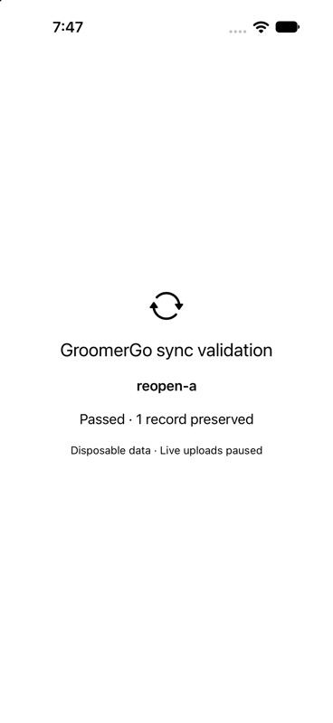
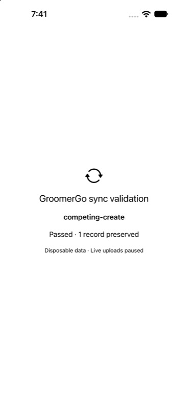

# Creation and durable retry gate — October 10, 2026

**Gate failed. Live uploads remain disabled.** Base44 keyed upsert did not enforce a unique `(businessId, recordUUID)` identity under simultaneous creation.

## Verified results

| Check | Result | Evidence |
| --- | --- | --- |
| Ten races, eight concurrent creation requests each | Four races left **two** rows for one identity, including after a 12-second wait | [Extended creation results](evidence/extended-concurrent-creation.json) |
| Read visibility | One race's immediate inspection returned zero rows; after waiting it returned one | Same report, `concurrent-creation-4` |
| Eight simultaneous identical operations on an already reserved record | One applied, seven replayed; one revision and one receipt | [Separate idempotency run](evidence/groomergo-creation-gate-3.json) |
| Lost acknowledgment retry | Original receipt returned without another revision | Same report |
| Changed body using the same operation ID on the same record | Rejected with `OPERATION_ID_REUSED` | Same report |
| Different operations against the same revision | One applied, one conflict | Same report |
| Retry an old operation after a later edit | Original acknowledgment returned; stored revision remained newer | Same report |
| Actual iOS Simulator upload/retry/download/relaunch | Passed on two separate Simulator instances | [Server verification](evidence/actual-two-simulator-server.json), device results below |
| Native test suite | 10 passed, zero failed/skipped | [Xcode test result](evidence/native-xcode-tests.json) |
| Backend/web tests | 26 passed | `npm test` |
| Probe disabled; production uploads paused; read-only authentication | All passed | [Final state](evidence/creation-final-state.json) |

The earlier three-race run passed, but subsequent reproducible duplicates invalidate any uniqueness claim. Both earlier failed runs are preserved. The extended run completed all ten creation races, then its additional idempotency section ended with `HARNESS_FAILED`; cleanup nevertheless confirmed zero remaining rows. Its creation observations are conclusive, and the separate idempotency run supplies the successful retry evidence. The reusable extended script now tests only creation.

## Actual two-Simulator sequence

Device A was iPhone 18 Pro (`9817E7E6-CB64-4DEC-BD53-E4E882D60746`), and device B was iPhone 18 Pro Max (`1E50A7A1-6265-4731-825A-E4AB0D7921BA`), both on iOS 27.0. These were running GroomerGo app processes with separate on-disk SwiftData stores, making HTTP calls to the deployed Base44 probe.

1. A saved one service and its pending operation before networking: [seed](evidence/native-a-seed.json).
2. A was terminated and relaunched without supplying the capability again. Its Keychain session was accepted. The server committed the operation, and the diagnostic transport deliberately discarded the acknowledgment: [lost acknowledgment](evidence/native-a-lost-ack.json).
3. A was terminated and relaunched again. It sent the **same operation ID and identical request bytes**, received `replayed`, and persisted acknowledgment revision 1: [retry](evidence/native-a-retry.json).
4. B attempted a competing create for the same business and record UUID. It persisted the conflict and downloaded the authoritative record into its own store: [device B](evidence/native-b-competing-create.json).
5. Both apps were terminated and relaunched. Their records, acknowledged/conflict queue states, revisions, and Keychain sessions survived: [A reopen](evidence/native-a-reopen-a.json), [B reopen](evidence/native-b-reopen-b.json).
6. Both were reopened again after installing the final build with the added queue ordering field. The persisted stores migrated and retained their state. Server inspection confirmed **one record, revision 1, one operation receipt**, then deleted the fixture and invalidated its run capability.

The lost-ack and retry SHA-256 values match: `aa7177d23d1b03dde73322612aa7e8222f0e6b721bef26d1668b255c4d4ac6a0`.

## iOS implementation

The working project remains `/Users/neerajdiwan/Documents/Codex/GroomerGo/GroomerGo.xcodeproj`. New source snapshots and tests are also available in this active workspace under [native](native/).

- `SyncOutboxItem` persists stable operation/record/business IDs, the bound account, payload, sequence, attempts, next retry date, frozen request bytes, and acknowledgment/conflict state.
- `SyncRecordCheckpoint` persists the latest acknowledged server revision and the last staged local value.
- Services, clients, pets, and appointments save local changes and pending operations together in one SwiftData save. Unassigned local work stays local. Missing previously staged records create durable deletion operations.
- Requests are saved before sending and reused unchanged after an ambiguous failure. Relaunch recovers `sending` operations without changing their request or retry deadline.
- Edits serialize per record. Different accounts cannot drain an owner's queue. Invalid receipts block the operation; revision conflicts stay visible in the queue and are not silently accepted.
- The shared scheme and stale test host/module names were corrected so tests actually run rather than reporting “No result.”

## Scope and next requirement

The live probe touched only disposable service fixtures, protected by deny-all direct entity rules and expiring, scoped capabilities. It did not read or write customer records. Keychain relaunch checks used a separate validation session through the same secure storage implementation; they did not repeat production Google sign-in or test physical phones. The probe's receipts are stored within each record and capped at 64; this is a diagnostic, not the final production receipt store.

The next backend requirement is an authoritative storage path that enforces unique record identities **and** business-scoped operation IDs with atomic persistence of the record and its acknowledgment. Keyed Base44 upsert alone is unsuitable. Do not promote the diagnostic handler, rely on a process-local lock, or enable production uploads/web slot reservations until that replacement passes concurrent creation, ambiguous retry, and restart tests.

All probe rows were cleaned up. The probe now returns HTTP 410 `PROBE_DISABLED`; production sync still returns HTTP 409 `RECORD_SYNC_REQUIRED`.
